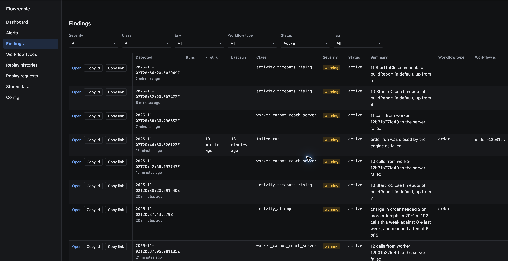
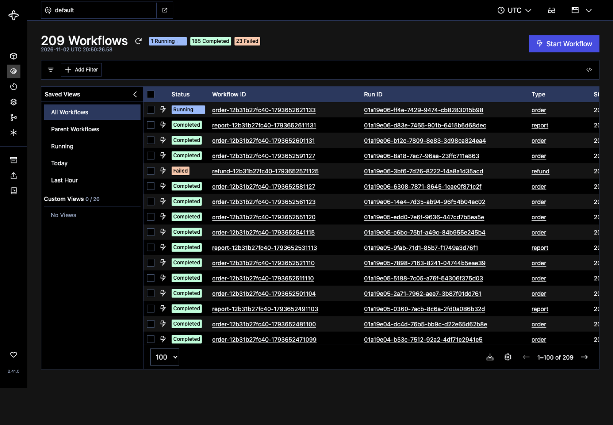
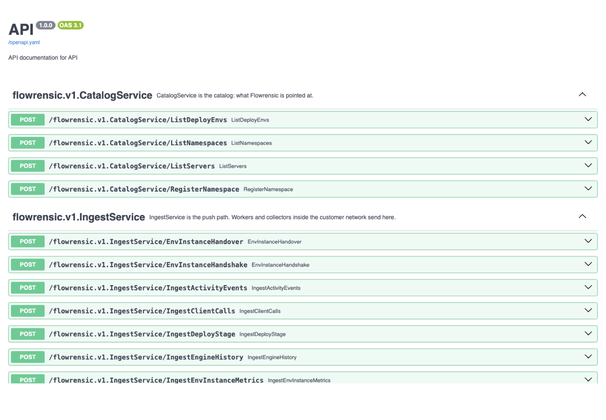
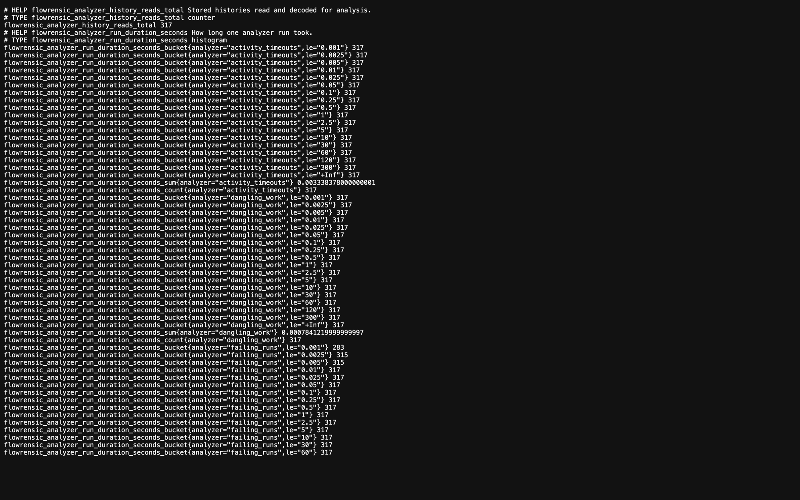
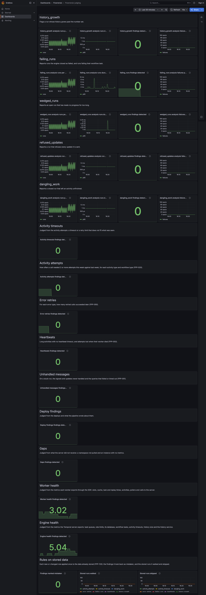
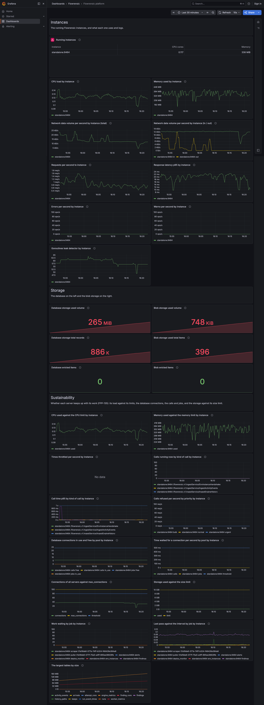
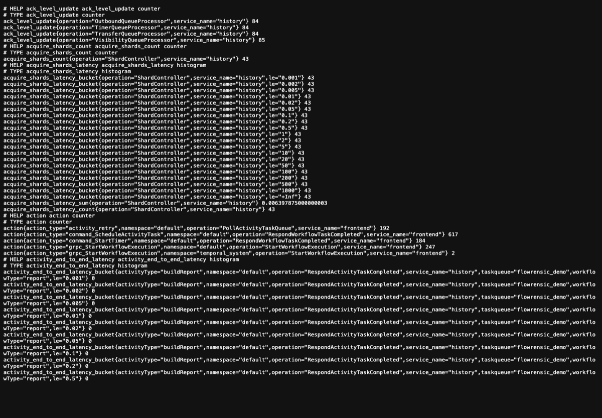

# Get Flowrensic running

The standalone Compose setup starts Flowrensic, Temporal, Prometheus, Grafana, and a demo worker. The demo worker creates sample findings so you can explore the UI immediately.

Create a directory for the Compose file, then copy the YAML below into a file named `docker-compose.yml`. Use the code block's copy button to copy the full file.

```bash
mkdir -p flowrensic-quickstart && cd flowrensic-quickstart
```

```yaml
# Start the standalone app and its preconfigured local monitoring stack with:
#   docker compose -f deploy/standalone/docker-compose.yml up -d
# The demo worker starts workflows that fail, retry, and time out so findings
# appear in Flowrensic without connecting the stack to an external Temporal service.
#
# With the default ports, open these URLs on the Docker host:
#   Flowrensic UI:                    http://127.0.0.1:8080/
#   Flowrensic API docs:               http://127.0.0.1:8080/docs
#   Flowrensic OpenAPI spec:           http://127.0.0.1:8080/openapi.yaml
#   Flowrensic health:                 http://127.0.0.1:8080/healthz
#   Flowrensic readiness:              http://127.0.0.1:8080/readyz
#   Flowrensic Prometheus metrics:     http://127.0.0.1:9464/metrics
#   Grafana home:                      http://127.0.0.1:3000/
#   Grafana judging dashboard:         http://127.0.0.1:3000/d/flowrensic-judging/flowrensic-judging
#   Grafana platform dashboard:        http://127.0.0.1:3000/d/flowrensic-platform/flowrensic-platform
#   Grafana storage and ingest:        http://127.0.0.1:3000/d/flowrensic-storage-and-ingest/flowrensic-storage-and-ingest
#   Temporal UI:                       http://127.0.0.1:8233/
#   Temporal gRPC:                     127.0.0.1:7233
#   Temporal Prometheus metrics:       http://127.0.0.1:9233/metrics
# Prometheus itself is internal to this Compose network at http://prometheus:9090/;
# it has no host port published by default. FLOWRENSIC_PORT,
# FLOWRENSIC_METRICS_PORT, and FLOWRENSIC_GRAFANA_PORT change the host ports.

services:
  standalone:
    image: ${FLOWRENSIC_STANDALONE_IMAGE:-flowrensic/flowrensic-standalone:latest}
    restart: unless-stopped
    environment:
      FLOWRENSIC_ENVS: '${FLOWRENSIC_ENVS:-[{"name":"local","kind":"dev","accessKey":"${FLOWRENSIC_LOCAL_ENV_KEY:-local-access-key}","readKey":"local-read-key","address":"temporal:7233","metricsAddress":"temporal:9233","namespaces":[{"name":"default"}]}]}'
      FLOWRENSIC_REQUIRED_ENVS: ${FLOWRENSIC_REQUIRED_ENVS:-local}
    depends_on:
      temporal:
        condition: service_healthy
    ports:
      - "${FLOWRENSIC_PORT_BIND:-127.0.0.1}:${FLOWRENSIC_PORT:-8080}:8080"
      - "${FLOWRENSIC_METRICS_BIND:-127.0.0.1}:${FLOWRENSIC_METRICS_PORT:-9464}:9464"
    volumes:
      - postgres-data:/var/lib/postgresql/data
      - blobs:/var/lib/flowrensic/blobs

  temporal:
    image: temporalio/temporal:1.5.0
    restart: unless-stopped
    command:
      - server
      - start-dev
      - --ip
      - 0.0.0.0
      - --ui-ip
      - 0.0.0.0
      - --metrics-port
      - "9233"
    ports:
      - "${TEMPORAL_PORT_BIND:-127.0.0.1}:${TEMPORAL_PORT:-7233}:7233"
      - "${TEMPORAL_UI_BIND:-127.0.0.1}:${TEMPORAL_UI_PORT:-8233}:8233"
      - "${TEMPORAL_METRICS_BIND:-127.0.0.1}:${TEMPORAL_METRICS_PORT:-9233}:9233"
    healthcheck:
      test: ["CMD", "temporal", "operator", "cluster", "health", "--address", "127.0.0.1:7233"]
      interval: 2s
      timeout: 5s
      retries: 15

  demo-worker:
    image: ${FLOWRENSIC_DEMO_WORKER_IMAGE:-flowrensic/flowrensic-demo-worker:latest}
    restart: unless-stopped
    depends_on:
      temporal:
        condition: service_healthy
      standalone:
        condition: service_healthy
    environment:
      TEMPORAL_ADDRESS: temporal:7233
      TEMPORAL_NAMESPACE: default
      TEMPORAL_TLS: "false"
      TEMPORAL_TASK_QUEUE: flowrensic-demo
      FLOWRENSIC_URL: http://standalone:8080
      FLOWRENSIC_DEPLOY_ENV: local
      FLOWRENSIC_ENV_KEY: ${FLOWRENSIC_LOCAL_ENV_KEY:-local-access-key}
      START_EVERY_SECONDS: ${FLOWRENSIC_DEMO_START_EVERY_SECONDS:-10}

  prometheus:
    image: ${FLOWRENSIC_PROMETHEUS_IMAGE:-flowrensic/flowrensic-prometheus:latest}
    restart: unless-stopped
    depends_on:
      - standalone
    command:
      - --config.file=/etc/prometheus/prometheus.yml
      - --storage.tsdb.path=/prometheus
      - --storage.tsdb.retention.time=15d
    volumes:
      - prometheus-data:/prometheus

  grafana:
    image: ${FLOWRENSIC_GRAFANA_IMAGE:-flowrensic/flowrensic-grafana:latest}
    restart: unless-stopped
    depends_on:
      - prometheus
    environment:
      GF_AUTH_ANONYMOUS_ENABLED: "true"
      GF_AUTH_ANONYMOUS_ORG_ROLE: Viewer
      GF_AUTH_DISABLE_LOGIN_FORM: "true"
    ports:
      - "${FLOWRENSIC_GRAFANA_BIND:-127.0.0.1}:${FLOWRENSIC_GRAFANA_PORT:-3000}:3000"

volumes:
  postgres-data:
  blobs:
  prometheus-data:
```

Start the stack from that directory:

```bash
docker compose up -d
```

The first start downloads the images. When the containers are healthy, open:

- [Flowrensic](http://127.0.0.1:8080/)
- [Grafana dashboards](http://127.0.0.1:3000/)
- [Temporal UI](http://127.0.0.1:8233/)

Flowrensic findings appear after the demo worker runs. Prometheus is included on the private Compose network and scrapes Flowrensic and Temporal metrics. The bundled Grafana is preconfigured with Flowrensic dashboards and opens without a login for local use.

To stop the stack, run `docker compose down`. To stop it and remove its persisted data, run `docker compose down -v`.

<Note>
  This Compose file is a local standalone demo. It starts its own Temporal server and demo worker. For an existing Temporal deployment, configure the standalone service to connect to that server and remove the demo worker service.
</Note>

## Add the Node SDK to a worker

Install the package in your Temporal worker project:

```bash
npm install @flowrensic/node
```

The standalone image registers a `local` environment and the `default` namespace. For a worker running on your host, use Flowrensic at `http://127.0.0.1:8080` and the local environment key `local-access-key` (change it before exposing the service beyond your machine). Get the namespace ID with:

```bash
curl -sS http://127.0.0.1:8080/flowrensic.v1.CatalogService/ListNamespaces \
  -H 'content-type: application/json' \
  -d '{}'
```

Use the `id` of the `default` namespace in the response below. Create a sink once when your worker process starts, then attach the activity interceptor. `envInstanceId` should identify this worker process; `version` can be your deployed code version.

```ts
import { Worker } from '@temporalio/worker';
import { createAttemptSink, flowrensicInterceptor } from '@flowrensic/node';

const namespaceId = process.env.FLOWRENSIC_NAMESPACE_ID!;
const env = {
  env: 'local',
  envInstanceId: process.env.HOSTNAME ?? 'my-worker',
  version: process.env.GIT_SHA,
};
const sink = createAttemptSink({
  baseUrl: process.env.FLOWRENSIC_URL ?? 'http://127.0.0.1:8080',
  envKey: process.env.FLOWRENSIC_ENV_KEY ?? 'local-access-key',
});

const worker = await Worker.create({
  // Keep your existing connection, namespace, taskQueue, and workflowsPath settings.
  connection,
  namespace: 'default',
  taskQueue: 'my-task-queue',
  workflowsPath,
  activities,
  interceptors: {
    activity: [flowrensicInterceptor(sink, namespaceId, env)],
  },
});

try {
  await worker.run();
} finally {
  await sink.close();
}
```

The SDK records one event per activity attempt and sends it to Flowrensic in batches. Telemetry failures do not fail the activity. Install Temporal's Node SDK packages alongside `@flowrensic/node`; the SDK requires Temporal 1.24 or newer.

## Screenshots

Browse the screens for each browser-accessible URL in the standalone Compose setup. Select a tab or use the arrow keys.

<Tabs>
  <Tab title="Findings">
    

    [Open Flowrensic findings](http://127.0.0.1:8080/findings)
  </Tab>
  <Tab title="Temporal UI">
    

    [Open Temporal UI](http://127.0.0.1:8233/)
  </Tab>
  <Tab title="API docs">
    

    [Open API docs](http://127.0.0.1:8080/docs)
  </Tab>
  <Tab title="Flowrensic metrics">
    

    [Open Flowrensic metrics](http://127.0.0.1:9464/metrics)
  </Tab>
  <Tab title="Judging dashboard">
    

    [Open judging dashboard](http://127.0.0.1:3000/d/flowrensic-judging/flowrensic-judging)
  </Tab>
  <Tab title="Platform dashboard">
    

    [Open platform dashboard](http://127.0.0.1:3000/d/flowrensic-platform/flowrensic-platform)
  </Tab>
  <Tab title="Storage and ingest">
    

    [Open storage and ingest dashboard](http://127.0.0.1:3000/d/flowrensic-storage-and-ingest/flowrensic-storage-and-ingest)
  </Tab>
  <Tab title="Temporal metrics">
    

    [Open Temporal metrics](http://127.0.0.1:9233/metrics)
  </Tab>
</Tabs>
